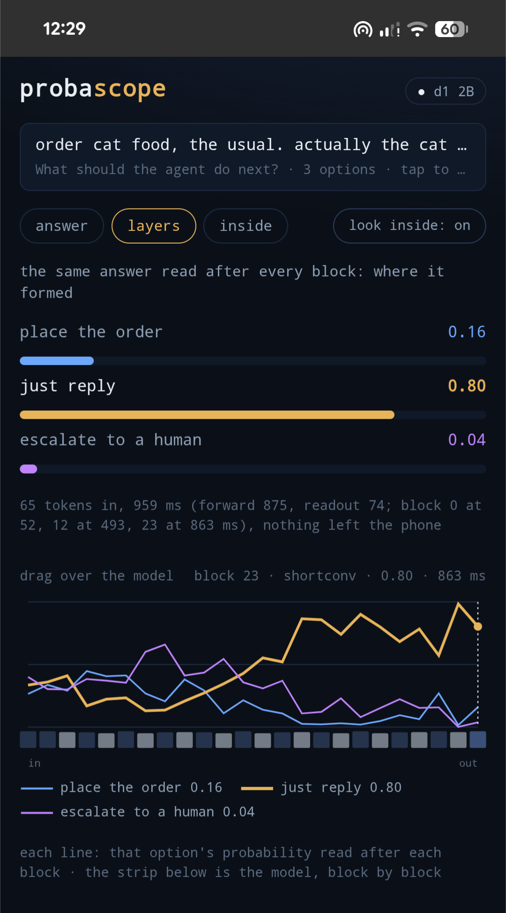
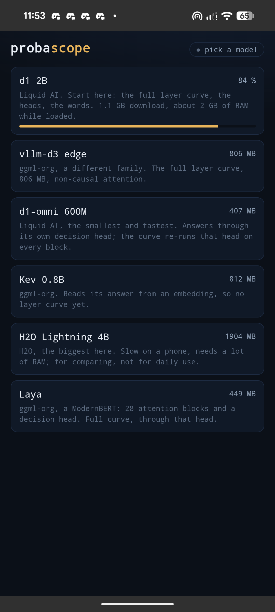

# probascope

I want to shove AI into the device and look inside it, because I believe the future is in
models we can see into, ideally on device. This is the looking-inside part, on a phone.

A Jev-like decision model runs natively in your Android phone ([kneejerk](https://github.com/moudrkat/kneejerk),
llama.cpp in the app, no server). Paste a text, ask one question, get probabilities in a few hundred
milliseconds. Then drag over the layers to see where the answer formed, and tap the blocks your
text went through. Nothing leaves the phone.

<p align="center">
  
  
</p>

## Install

1. On the phone, open the [releases page](https://github.com/moudrkat/probascope/releases), tap `probascope.apk`.
2. Allow installs from this source, install.
3. Pick a model: **d1 2B** (1.1 GB, the full picture) or **d1-omni 600M** (407 MB, fast).
4. Text, question, two or more options (none = yes/no), **decide**.

Pixel 8a, d1 2B: about 0.5 s per decision, 0.96 s with the look inside (forward 875 ms, readout 74 ms, 65 tokens).

## What you see

- **answer**: one probability per option, and the time.
- **layers**: the same answer read after every block. Drag to replay the bars at any block.
- **inside**: the blocks of the model, each as big as its weights, brighter where it worked on
  your words. Tap a block for its heads and the words it changed.

The curve is verified for all six models: on the last block it reproduces the model's own answer
to 0.0000 (d1-omni 600M to 0.001). Each family is read the way it answers: label logits (d1 2B,
vllm-d3, H2O Lightning), a trained decision head re-run on every block (d1-omni, Laya), or
question · option (Kev). Early blocks of a logit lens can mislead.

## Build it yourself

Node 22, Android SDK with NDK 27 and cmake, JDK 21.

```bash
git clone --recurse-submodules https://github.com/moudrkat/kneejerk
git clone https://github.com/moudrkat/probascope
cd probascope && npm install && npm run build && npx cap sync android
cd android && ./gradlew assembleDebug      # app/build/outputs/apk/debug/app-debug.apk
```

## PRs welcome

Numbers from your phone (model, ms, RAM). A model: one entry in `src/models.ts`, tried on a
phone, ms in the PR. The iOS side of the plugin. A curve for a family without one (see kneejerk,
`tests/layers.py`). Play testers, when it is time.

## Next

Attention per option, patching between two texts (which block
flips the answer), the same question across models, a calibration check on your examples,
images and audio as the state, iOS.
